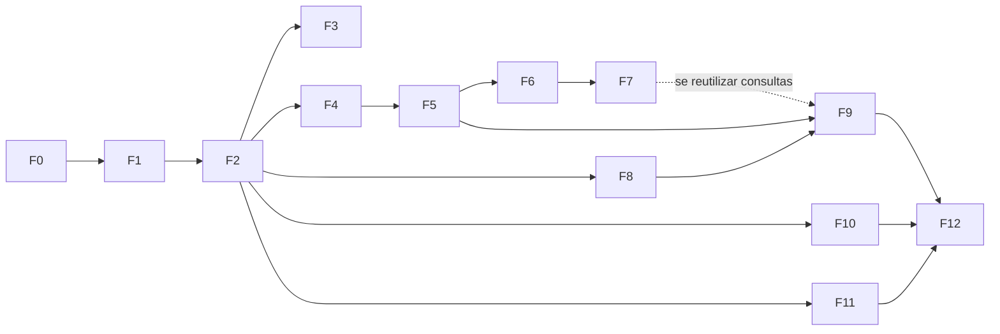

# Roadmap de Execução por Fatias Verticais

> **Estado (2026-10-27):** ordem aprovada em 2026-10-25 e refletida na spec 47; F0, F1 e F2 concluídas e F4 a F9 implementadas (com pendências atribuídas a fatias posteriores, ver "Estado das fatias" na spec 47); F3 com fluxos criados, aguardando execução verde no GitHub Actions; próxima: F10 (Preferências). Deriva de [47-implementation-plano-e-sequencia](../specs/47-implementation-plano-e-sequencia/spec.md) e das dependências das specs; ver "Alterações em relação à proposta anterior da spec 47".

## Princípio

Cada **fatia** entrega um pedaço utilizável do produto: primeiro o backend do módulo, depois a página correspondente no frontend, e termina com um **ponto de verificação** que o utilizador consegue testar de ponta a ponta. Nenhuma fatia começa sem a anterior estar verificada. Ritmo e método de cada fatia seguem [Como executar](./como-executar.md).

## Ponto de partida

- Spec 01 concluída: `api-finance-controller/` gerado e validado (Docker não verificado).
- Frontend (`app-finance-controller/`) ainda não existe.
- Repositório Git sem commits (P-23, manual).
- Fora da sequência: 21 e 38 (canceladas), deploy/INFRA-08 (adiado, P-18), cópia de segurança do banco (P-27).

## Visão geral

| Fatia | Entrega | Specs backend | Specs frontend | Você consegue testar |
|---|---|---|---|---|
| **F0** | Aprovar plano + commit inicial | 02–05 (revisão) | — | Repositório com histórico; `mvnw verify` verde |
| **F1** | Backend base + `identity` | 06, 08 (V1), 10, 11, 13, 39–41 | — | Cadastro e login via Swagger/curl; erros padronizados; isolamento entre utilizadores |
| **F2** | Frontend base + autenticação | — | 23, 24, 25, 26, 27, 28, 29, 30 | Cadastrar, entrar, sair e rota protegida no navegador, contra a API real |
| **F3** | CI mínimo | 42 (backend) | 42 (frontend) | Pipeline verde a cada push |
| **F4** | Categorias | 15 | 34 | Criar/editar/excluir categorias e subcategorias; semeadura no cadastro; módulo `example` removido |
| **F5** | Lançamentos | 16 | 33 | Registar receitas/despesas, filtrar e listar; alerta com implementação falsa |
| **F6** | Metas de gastos | 18 | 36 | Definir meta por categoria e ver o alerta real ao lançar |
| **F7** | Dashboard | 17 | 32 | Visão geral do mês com totais e progresso das metas |
| **F8** | Cofrinhos | 19 | 35 | Criar cofrinho, depositar/retirar; saldo nunca negativo |
| **F9** | Relatórios | 20 | 37 | Relatórios por período/categoria incluindo cofrinhos |
| **F10** | Preferências | 22 | 27 (integração) | Preferências persistem entre sessões e dispositivos |
| **F11** | Recuperação de senha | 48 | 49 | Fluxo "esqueci a senha" com e-mail capturado no SMTP local |
| **F12** | Endurecimento | 14, 40, 43, 44, 45, 46 | 31 | Suíte completa, E2E, segurança, observabilidade |

F8, F10 e F11 só dependem das fatias indicadas; podem trocar de lugar sem violar dependências (ver "Flexibilidade").

## Detalhe das fatias

### F0 — Aprovação e repositório
- Rever e aprovar este roadmap e a spec 47 (ajustes abaixo).
- Fazer o primeiro commit (manual — P-23).
- **Sai quando:** plano aprovado e `git log` com o ponto de partida.

### F1 — Backend base + identidade
- **Specs:** 06 (estrutura de módulos), 08 (Flyway V1), 10 (erros), 11 (identity), 13 (config/logs), 39–41 (execução local com `compose`).
- **Ordem interna:** contrato `identity` (prévia a aprovar) → migração → domínio → casos de uso → controller → testes de isolamento.
- **Verificação:** `mvnw clean verify` verde; cadastro, login e acesso a rota protegida funcionam via Swagger; um utilizador não acede a dados de outro.
- **Porquê primeiro:** todos os módulos dependem do `identity` e do filtro de proprietário.

### F2 — Frontend base + autenticação
- **Specs:** 23, 24, 25, 26, 27, 28, 29, 30 — scaffold `app-finance-controller`, shell, tokens, HTTP, estado, formulários, guardas de rota.
- Gerado a partir do contrato `identity` da F1.
- **Verificação:** build verde; fluxo cadastro → login → área protegida → sair no navegador; primeiro teste ponta a ponta manual.
- É a fatia maior do frontend; os padrões que ela fixa são reaproveitados por todas as seguintes.

### F3 — CI mínimo
- **Spec:** 42 (somente esteiras de backend e frontend; deploy fica de fora).
- **Entrada:** repositório remoto e F1+F2 existentes.
- **Verificação:** push dispara build + testes de ambos os lados.

### F4 — Categorias
- **Specs:** 15 + 34. Semeadura de categorias no cadastro; remover módulo `example`.
- **Verificação:** novo utilizador já vê as categorias padrão; CRUD completo na página; teste de isolamento.

### F5 — Lançamentos
- **Specs:** 16 + 33. Porta de alerta de meta com implementação falsa.
- **Divisão sugerida (spec 47, regra 9):** 5a listar + criar; 5b editar + excluir + filtros.
- **Verificação:** lançamentos aparecem corretamente por mês/categoria; valores decimais sem perda de precisão no frontend.

### F6 — Metas de gastos
- **Specs:** 18 + 36. Troca a implementação falsa do alerta pela real.
- **Verificação:** ultrapassar uma meta ao lançar gera o alerta esperado.

### F7 — Dashboard
- **Specs:** 17 + 32.
- **Verificação:** totais do mês batem com os lançamentos; progresso de metas coerente.

### F8 — Cofrinhos
- **Specs:** 19 + 35. Não depende de F4–F7 (só F1+F2); pode subir para logo depois da F2 se quiser variar.
- **Verificação:** saldo nunca negativo (teste de concorrência incluído).

### F9 — Relatórios
- **Specs:** 20 + 37. **Entrada:** F5 e F8 (e F7 se reutilizar consultas do dashboard).

### F10 — Preferências
- **Specs:** 22 + integração de estado da 27.

### F11 — Recuperação de senha
- **Specs:** 48 + 49; SMTP de captura no `compose`.
- Isolada: pode ser adiantada se preferir ter o fluxo de conta completo cedo.

### F12 — Endurecimento
- **Specs:** 14, 31, 40, 43, 44, 45, 46. Cobertura completa, E2E, segurança, desempenho, observabilidade.
- Os testes unitários e de integração de cada módulo já nascem nas fatias anteriores; aqui fecha-se o que faltar.

## Ritmo de cada fatia

1. Contrato OpenAPI do módulo (prévia aprovada por si).
2. Migração + domínio + testes de domínio.
3. Casos de uso + adaptadores JPA + controller.
4. Testes de isolamento entre utilizadores; `mvnw clean verify`.
5. Página do frontend a partir do contrato.
6. Teste ponta a ponta manual (o "Você consegue testar" da tabela) e registo da evidência na spec.
7. Atualizar matriz de rastreabilidade e rever este roadmap.

## Alterações em relação à proposta anterior da spec 47

Aprovadas em 2026-10-25 e já refletidas na spec 47 (que agora usa F0–F12); a spec 47 é a fonte da sequência.

| Proposta anterior (M0–M10) | Atual | Motivo |
|---|---|---|
| Backend (M1) e frontend base (M2) em paralelo | Em série: F1 depois F2 | Você quer ver progresso e testar a cada passo; um só fio de trabalho. |
| Recuperação de senha logo após M1 (M1b/M2b) | F11, mais adiante | Não bloqueia nenhum módulo financeiro; depende de SMTP. |
| Metas+dashboard num marco (M6) | Metas (F6) e dashboard (F7) separados | Entregas menores e verificáveis. |
| Testes só no M10 | Testes por fatia, F12 só consolida | Detecta regressões cedo. |

## Flexibilidade

- F8, F10 e F11 podem ser antecipadas após a F2.
- F3 pode esperar até depois da F4 se o repositório remoto ainda não existir.
- Qualquer fatia pode ser dividida mantendo rastreabilidade na matriz.
