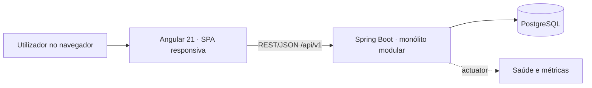
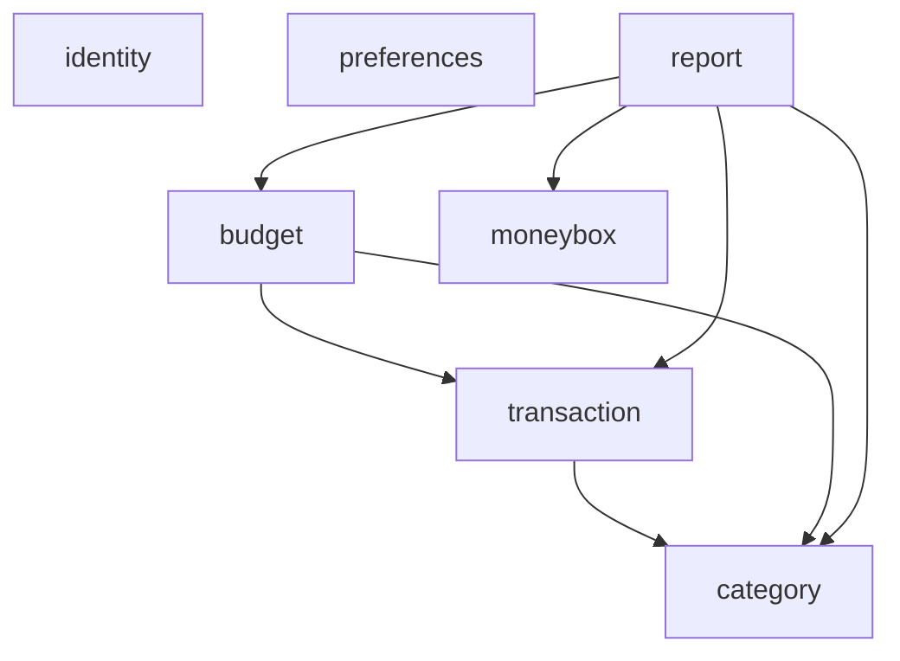

# 03-global-arquitetura-e-requisitos-transversais

> **ID:** GLOBAL-SPEC-01 · **Categoria:** Global · **Estado:** proposta para revisão — não aprovada, não executada.

Este é o documento de arquitetura do conjunto de specs. Detalhes de camada ficam em [BACKEND-SPEC-00](../06-backend-arquitetura-java-spring/spec.md) e [FRONTEND-SPEC-00](../23-frontend-arquitetura-angular/spec.md).

## Objetivo

Definir a arquitetura-alvo, os requisitos transversais e as restrições que todas as specs de módulo devem cumprir, sem repetir as decisões já tomadas no [contexto técnico global](../../memory/contexto-tecnico.md).

## Escopo

- Inclui: visão de contexto e de módulos, regras de dependência, requisitos não funcionais, restrições e decisões arquiteturais (ADR).
- Não inclui: detalhes de classes, tabelas e componentes (specs específicas); escolha de nuvem e implantação (INFRA-SPEC-07/08).

## Contexto técnico local

### Visão de contexto (PROPOSTO)

### Módulos do backend e dependências (PROPOSTO — ADR-001)

Todos os módulos de dados obtêm o proprietário do contexto de autenticação de `identity` (não é uma dependência de tipos de domínio). O módulo `backup` não existe (P-03).

- Setas indicam "depende de". Não há ciclos. Quando uma regra exige conhecimento no sentido oposto, o módulo dono define uma porta (SPI) que o outro implementa:
  - `category` define `CategoryUsageGuard` (a categoria está em uso?); `transaction` a implementa. Origem: DESC-CAT-03.
  - `transaction` define `BudgetImpactPort` (impacto de uma despesa na meta); `budget` a implementa. Origem: DESC-BUD-06/07.
- A meta geral de reservas (DESC-BOX-09) pertence ao módulo `moneybox` no destino (tabela `reserve_goal`).
- O pacote do contrato gerado (`...generated`) é um módulo Modulith aberto, conforme o scaffold ([spec 01](../01-scaffold-backend-spring-modulith/spec.md)).

### Requisitos transversais

| ID | Requisito | Classe | Origem |
|---|---|---|---|
| RT-01 | O backend é a fonte da verdade para saldos, totais, metas, alertas e relatórios; o frontend não recalcula regras oficiais. | PROPOSTO | contexto técnico global; DESC-DAT-01 |
| RT-02 | Dinheiro em `BigDecimal` (Java) e `NUMERIC(19,2)` (banco), moeda sempre explícita ao lado do valor. Comparações de limiar são exatas, sem divisão intermediária. | PROPOSTO (ADR-002) | DESC-DAT-03 |
| RT-03 | Data financeira é `LocalDate` (sem fuso); criação e atualização são `Instant`. Mês de referência é `YYYY-MM`. | PROPOSTO (ADR-003) | DESC-DAT-04 |
| RT-04 | BRL e EUR nunca se somam nem se convertem. Toda consulta agregada recebe a moeda. | CONFIRMADO | DESC-CUR-02 |
| RT-05 | Erros seguem RFC 9457 (Problem Details) com `code` estável, mensagem em português do Brasil e campos afetados. | PROPOSTO (ADR-007) | contexto técnico global |
| RT-06 | Operações compostas (excluir cofrinho com movimentações, importar backup, salvar meta) são atómicas. | PROPOSTO | DESC-BOX-08, DESC-BKP-03 |
| RT-07 | Integridade referencial e unicidade protegidas também no banco. | PROPOSTO | DESC-DAT-02, DESC-CAT-02 |
| RT-08 | Interface em português do Brasil, datas `dd/MM/yyyy`, valores `R$ 1.234,56` / `€ 1.234,56`. | CONFIRMADO | DESC-PRF-02, DESC-CUR-07 |
| RT-09 | Interface responsiva (computador, tablet, celular pelo navegador), acessível por teclado, com estados de carregamento, vazio, erro e sucesso. | CONFIRMADO (produto) | produto.md |
| RT-10 | Segredos fora do código; dados financeiros reais nunca em testes ou repositório. | CONFIRMADO | contexto técnico global |
| RT-11 | Autenticação por e-mail e senha; cada utilizador só acessa os seus dados (`owner_id` em todas as tabelas, proprietário vindo do token, 404 para recurso alheio). | DECIDIDO (P-01, ADR-012) | DESC-DAT-01 |
| RT-12 | Entrega em imagens Docker independentes (backend e frontend); sem requisito offline nem PWA. | DECIDIDO (P-02, ADR-014) | DESC-INF-01 |
| RT-13 | Consultas JPA otimizadas: agregações e paginação no banco, sem N+1, índices guiados pelas consultas. | DECIDIDO (P-17) | contexto técnico global |

### Metas não funcionais (PROPOSTO, a aprovar)

- Consultas mensais e relatórios com p95 abaixo de 500 ms para até 50 000 lançamentos por utilizador (hipótese; a origem não tem medições).
- Listagens paginadas; nenhuma resposta ilimitada.
- Cobertura mínima de testes definida em [QUALITY-SPEC-00](../44-quality-estrategia/spec.md).

### Restrições

- Sem microserviços, mensageria, CQRS, event sourcing ou microfrontends (contexto técnico global).
- Sem lógica de negócio em controllers ou templates.
- O Flutter de origem não é alterado.

### Decisões e riscos

ADR-001, 002, 003, 005, 007, 012 e 014 em [decisões](../00-engenharia-reversa/decisoes-adr.md). P-01 fechada: `owner_id` desde a primeira migração. Risco principal: esquecer o filtro de proprietário em alguma consulta — mitigado por teste de isolamento por recurso e por filtro central.

## Referências

- [Produto](../../memory/produto.md)
- [Contexto técnico global](../../memory/contexto-tecnico.md)
- [Como executar](../../shared/como-executar.md)
- [Scaffold do backend](../01-scaffold-backend-spring-modulith/spec.md)
- [Decisões](../00-engenharia-reversa/decisoes-adr.md)

## Regras e critérios de aceitação

- [ ] Nenhuma spec de módulo contradiz RT-01…RT-13 sem registar uma exceção aprovada.
- [ ] O grafo de módulos não tem ciclos; `ModularityTests` passa (verificável na implementação).
- [ ] Cada valor monetário em contrato, código e banco declara escala 2 e moeda.
- [ ] As decisões ADR-001…ADR-014 têm estado `aprovada`, `delegada`, `cancelada` ou `rejeitada` antes de o módulo correspondente começar (estado atual em [decisoes-adr.md](../00-engenharia-reversa/decisoes-adr.md)).

### Skills de implementação

- **Skills obrigatórias:** `java-modern-engineering` e `angular-architect` (consulta de princípios); `java-spring-scaffold` já foi aplicada na spec 01.
- **Caminhos:** `C:\Users\dowgl\.codex\skills\java-modern-engineering\SKILL.md`; `.claude/skills/angular-architect/SKILL.md`; `C:\Users\dowgl\.codex\skills\java-spring-scaffold\SKILL.md`.
- **Responsabilidade:** `java-modern-engineering` para escolhas de linguagem e invariantes; `angular-architect` para fronteiras do frontend.
- **Momento de utilização:** ao desenhar cada módulo; não há implementação nesta spec.
- **Dependências:** ADRs aprovadas.
- **Limitações:** não existe skill específica de arquitetura transversal, segurança ou observabilidade nos diretórios indicados.

## Tasks

### Descoberta e decisão

- [ ] Aprovar ou ajustar as ADRs ainda em estado `proposta` (001, 003, 005, 007, 010, 011) e as `delegada` (008, 012 técnica, 013).

### Validação

- [ ] Rever cada spec de módulo contra RT-01…RT-13 antes da sua aprovação.

## Resultado esperado

- Arquitetura e regras transversais aprovadas, usadas como critério de revisão de todas as specs.
- Preservada a decisão de monólito modular e arquitetura limpa.

## Encerramento

Esta mudança termina quando os critérios de aceitação forem atendidos, as tarefas ativas estiverem marcadas com evidência e as verificações pertinentes forem concluídas, conforme [Como executar](../../shared/como-executar.md).
