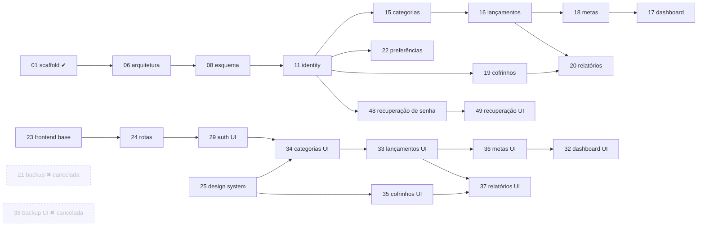

# 47-implementation-plano-e-sequencia

> **ID:** IMPLEMENTATION-SPEC-00 · **Categoria:** Planejamento · **Estado:** sequência por fatias verticais (F0–F12) aprovada pelo utilizador em 2026-10-25; nenhuma fatia executada. Detalhe em [roadmap](../../shared/roadmap.md).

## Objetivo

Ordenar a futura implementação em fatias com dependências, paralelismo possível e critérios de conclusão, sem iniciar nenhuma delas.

## Escopo

- Inclui: sequência recomendada, dependências entre specs, condições de entrada de cada fatia, critérios de conclusão.
- Não inclui: execução de qualquer spec. Aprovar este plano **não** autoriza implementação (Como executar).

## Contexto técnico local

### Ponto de partida

[Spec 01](../01-scaffold-backend-spring-modulith/spec.md) concluída: projeto backend gerado e validado, com a ressalva de Docker não verificado. Nenhum frontend existe. Duas correções locais ao scaffold (controller não `final`; módulo `generated` aberto) devem ser lembradas se o scaffold for regenerado. Todas as decisões do produto (P-01…P-28) estão em [pendencias.md](../00-engenharia-reversa/pendencias.md); nenhuma pendência bloqueia o primeira fatia.

### Specs fora da sequência

- **Canceladas:** 21 (backup e importação) e 38 (página de backup) — P-03, P-16.
- **Adiada:** INFRA-SPEC-08 (deploy) — P-18.
- **Fora do escopo:** INFRA-SPEC-11 (cópia de segurança do banco) — P-27; verificação de e-mail e exclusão de conta — não solicitadas.
- **Novas:** 48 (recuperação de senha, backend) e 49 (recuperação de senha, frontend) — P-24.

### Marcos

Cada fatia entrega o backend de um módulo e, em seguida, a página correspondente, terminando num ponto de verificação testável pelo utilizador. As fatias executam **em série**, em ordem.

| Fatia | Conteúdo | Specs | Condição de entrada |
|---|---|---|---|
| F0 | Revisão e aprovação das specs; primeiro commit/repositório Git (P-23, manual); backend gerado já movido para `api-finance-controller/` na raiz (spec 01, concluído em 2026-10-24 — P-28) | 01, 02–05 | — |
| F1 Backend base + `identity` | Estrutura de módulos, erros, configuração, Flyway, cadastro/entrada/isolamento | 06, 08 (V1), 10, 11, 13, INFRA 39–41 | F0 |
| F2 Frontend base + autenticação | Scaffold Angular `app-finance-controller` na raiz, shell, tokens, estado, HTTP, formulários, guardas de rota | 23, 24, 25, 26, 27, 28, 29, 30 | F1 (contrato `identity`) |
| F3 CI mínimo | Esteiras de backend e frontend separadas | 42 | repositório remoto (P-23); F1 e F2 |
| F4 Categorias | Módulo + página; semeadura no cadastro; remover o módulo `example` | 15, 34 | F2 |
| F5 Lançamentos | Módulo + página; porta de alerta com implementação falsa | 16, 33 | F4 |
| F6 Metas de gastos | Módulo de metas, alerta real, página | 18, 36 | F5 |
| F7 Dashboard | Visão geral com meta, página | 17, 32 | F6 |
| F8 Cofrinhos | Módulo + página (saldo nunca negativo) | 19, 35 | F2 (independe de F4–F7) |
| F9 Relatórios | Módulo + página | 20, 37 | F5, F8 (e F7 se reutilizar consultas) |
| F10 Preferências | Módulo servidor e integração com o estado | 22, 27 | F2 |
| F11 Recuperação de senha | E-mail, token de uso único, revogação de sessões, SMTP de captura no `compose`; páginas `/esqueci-senha` e `/redefinir-senha` | 48, 49 | F2 |
| F12 Endurecimento | Consolidação de testes, segurança, E2E, observabilidade, operação | 14, 31, 40, 43–46 | fatias anteriores |

F8, F10 e F11 podem ser antecipadas após F2; F3 pode esperar até depois de F4 se não houver repositório remoto.

Hospedagem e deploy ficam fora da sequência até P-18 ser decidida.

### Alterações em relação à proposta anterior (aprovadas em 2026-10-25)

- Marcos M0–M10 substituídos por fatias F0–F12; correspondência anterior → atual: M1→F1, M2→F2, M3→F3, M4→F4, M5→F5, M6→F6+F7, M7→F8, M8→F9, M9→F10, M1b+M2b→F11, M10→F12.
- Backend e frontend base deixam de correr em paralelo (F1 antes de F2) para permitir progresso verificável passo a passo.
- Recuperação de senha (antes M1b/M2b, logo após M1) passa a F11, por não bloquear módulos financeiros.
- Metas e dashboard (antes M6) separados em F6 e F7.
- Testes unitários, de integração e de isolamento passam a ser escritos em cada fatia; F12 apenas consolida.

### Dependências entre specs

### Paralelismo seguro

- A execução padrão é em série (uma fatia de cada vez). O ponto de acoplamento entre backend e frontend é o contrato `identity` (F1 → F2).
- F8 (cofrinhos), F10 e F11 não dependem de F4–F7 e podem ser antecipadas ou, se o utilizador pedir, executadas em paralelo, por tocarem módulos distintos.
- Cada módulo é uma entrega curta e independente (contrato → backend → frontend), com spec e evidência próprias. Dois módulos nunca editam os mesmos ficheiros.

### Ordem dentro de cada módulo

1. Contrato (prévia aprovada pelo utilizador). 2. Migração. 3. Domínio e testes de domínio. 4. Casos de uso, adaptadores JPA com consultas otimizadas. 5. Controller. 6. Testes de isolamento entre utilizadores. 7. Frontend da página. 8. Validação de contrato e E2E parcial.

### Critérios de conclusão por fatia

Todos os critérios de aceitação das specs da fatia marcados com evidência; `mvnw clean verify` e build do frontend verdes; contratos validados; testes de isolamento passando; matriz de rastreabilidade atualizada; sem bloqueios abertos.

### Aderência ao fluxo SDD

O template exige uma spec curta por entrega: as specs desta análise são o **conjunto de entregas candidatas**, não uma única mudança. Qualquer uma pode ser dividida (por exemplo, `listTransactions` e `createTransaction`) mantendo a rastreabilidade (regra 9 de "Como executar").

### Riscos

- Esquecer o filtro de proprietário numa consulta (mitigado por filtro central e testes de isolamento).
- `openapi-rest-contract` exige aprovação interativa da prévia, o que impede execução totalmente automática.
- Entregabilidade do e-mail de recuperação depende do provedor e do domínio remetente, só definidos com a hospedagem (P-18).
- Sem cópia de segurança do banco por decisão do produto (P-27).

## Referências

- [Produto](../../memory/produto.md)
- [Contexto técnico global](../../memory/contexto-tecnico.md)
- [Como executar](../../shared/como-executar.md)
- [Índice geral](../00-engenharia-reversa/README.md)
- [Pendências](../00-engenharia-reversa/pendencias.md)

## Regras e critérios de aceitação

- [ ] Nenhuma fatia começa sem as condições de entrada da tabela.
- [ ] A ordem respeita as dependências do diagrama.
- [ ] Cada fatia termina com evidência registada conforme "Como executar".
- [ ] Alterações no plano (nova fatia, divisão de spec) mantêm a rastreabilidade na matriz.

### Skills de implementação

- **Skills obrigatórias:** as listadas em cada spec; esta spec não executa nenhuma.
- **Caminhos:** ver cada spec. Resumo: `java-modern-engineering`, `java-spring-create-module`, `openapi-rest-contract` em `C:\Users\dowgl\.codex\skills\`; `angular-architect`, `angular-module-scaffold`, `angular-frontend-scaffold`, `angular-tailwind-ui-specialist` em `.claude/skills/`.
- **Responsabilidade:** ver catálogo no [índice](../00-engenharia-reversa/README.md#skills).
- **Momento de utilização:** conforme a fatia.
- **Dependências:** `openapi-rest-contract` antes de `java-spring-create-module` e `angular-module-scaffold` em cada módulo.
- **Limitações:** sem skills para banco, segurança, CI/CD, observabilidade, E2E e infraestrutura.

## Tasks

### Descoberta e decisão

- [x] Aprovar o plano.
  > ✅ 2026-10-25 — Sequência por fatias F0–F12 aprovada pelo utilizador em conversa. Verificação: decisão registada nesta spec e em [roadmap](../../shared/roadmap.md).
- [ ] Criar o repositório do projeto e o primeiro commit (manual — P-23). A renomeação do backend (spec 01) já foi feita.

### Validação

- [ ] Rever o plano ao fim de cada fatia e registar ajustes.

## Resultado esperado

- Sequência de entrega clara, com dependências visíveis antes de qualquer implementação.
- Preservado o princípio de especificar e aprovar antes de implementar.

## Encerramento

Esta mudança termina quando os critérios de aceitação forem atendidos, as tarefas ativas estiverem marcadas com evidência e as verificações pertinentes forem concluídas, conforme [Como executar](../../shared/como-executar.md).
